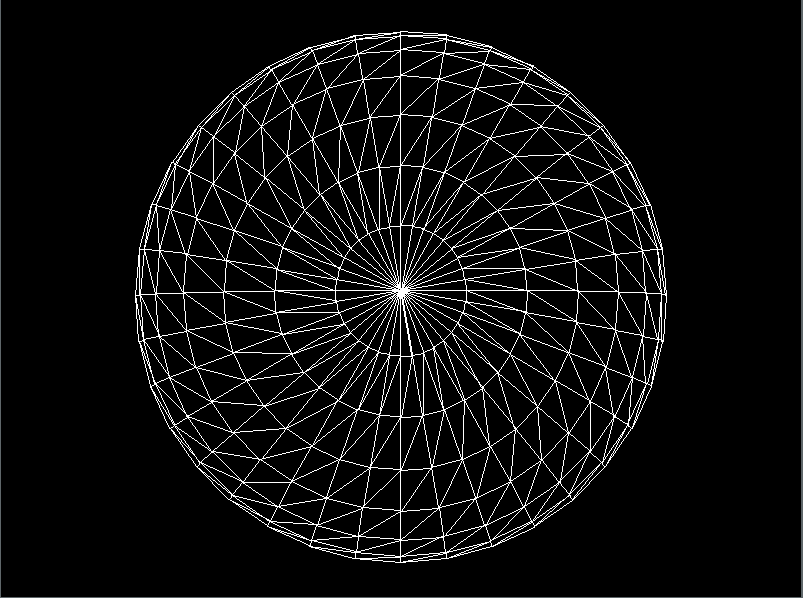

# Software renderer

A small 3D **software renderer** written in C. All rasterization happens on the CPU into a plain `uint32_t` framebuffer, and SDL3 is used only for the window, input, and presenting the finished frame.

> Status: work in progress, built for learning how the graphics pipeline works.

## Features

- Full CPU pipeline: model -> view -> projection -> perspective divide -> viewport
- Wireframe rendering with Bresenham line drawing
- Filled triangles with a block-based half-space rasterizer (8×8 tiles, fixed-point coordinates)
- Procedural UV sphere / ellipsoid generator (`elip`) with separate radii per axis
- Free-fly camera (yaw/pitch, `lookat` view matrix)
- Back-face culling and near-plane rejection
- Bounds-checked pixel writes

## Demo photo


## Project layout

```
software-renderer/
├── CMakeLists.txt
├── core/
│   ├── camera.c/.h       # fly camera, view/projection matrices
│   ├── elip.c/.h         # ellipsoid mesh generation and drawing
│   ├── framebuffer.c/.h  # framebuffer + set_pixel (bounds-checked)
│   ├── raster.c/.h       # line and triangle rasterization, vertex/face types
│   ├── renderer.c/.h     # MVP helpers, viewport transform, culling, object_draw
│   ├── utils.h           # MIN/MAX macros
│   ├── math/             # vec3/vec4, mat4
│   ├── scene/            # mesh, object, transform
│   └── system/           # SDL3 window, input polling, presenting
├── external/         # third-party dependencies (SDL3)
└── main/             # demo application
```

## Requirements

- C compiler (GCC or Clang)
- CMake 3.x or newer
- SDL3 (expected under `external/`, or installed system-wide)

## Build and run

```sh
cmake -S . -B build
cmake --build build
```

The demo opens an 800×600 window showing a wireframe sphere (36 sectors × 18 stacks) that you can fly around and through.

## Controls

The camera responds to the following input flags, defined in `core/system/system.c`:

| Action        | Input flag |
| ------------- | ---------- |
| Move forward  | `forward`  |
| Move backward | `backward` |
| Strafe left   | `left`     |
| Strafe right  | `right`    |
| Move up       | `up`       |
| Move down     | `down`     |
| Quit          | `quit`     |

Check `system_poll` to see which keys map to each flag.

## How a frame is drawn

1. Clear the framebuffer.
2. Poll input and update the camera (`camera_update`).
3. For each object, build the MVP matrix: `proj * view * model`.
4. Transform every vertex to clip space (`build_mvp_position`).
5. Skip triangles with any vertex closer than `NEAR_W` (clip-space `w`).
6. Divide by `w` and map to screen coordinates (`convert_to_ndc`, which actually performs the viewport transform).
7. Cull back faces, then rasterize filled or as wireframe.
8. Present the framebuffer through SDL.

## Using the ellipsoid generator

```c
elip_t* elip = elip_create(
    (vec3f_t){1.0f, 1.0f, 1.0f},   // radii (x, y, z)
    36, 18,                        // sectors, stacks
    (vec3f_t){0, 0, 0},            // position
    (vec3f_t){0, 0, 0},            // rotation
    (vec3f_t){1, 1, 1},            // scale
    0xFFFFFF,                      // color (0xRRGGBB)
    RENDER_WIREFRAME               // or RENDER_FILLED
);

elip_draw(elip, &fb, cam->view_mat, cam->projection_mat);
elip_free(elip);
```

The final size is `radii * scale`, so keep `scale` at `(1,1,1)` if `radii` alone should define the shape.

## Creator 
Oleksandr Pysarchuk
